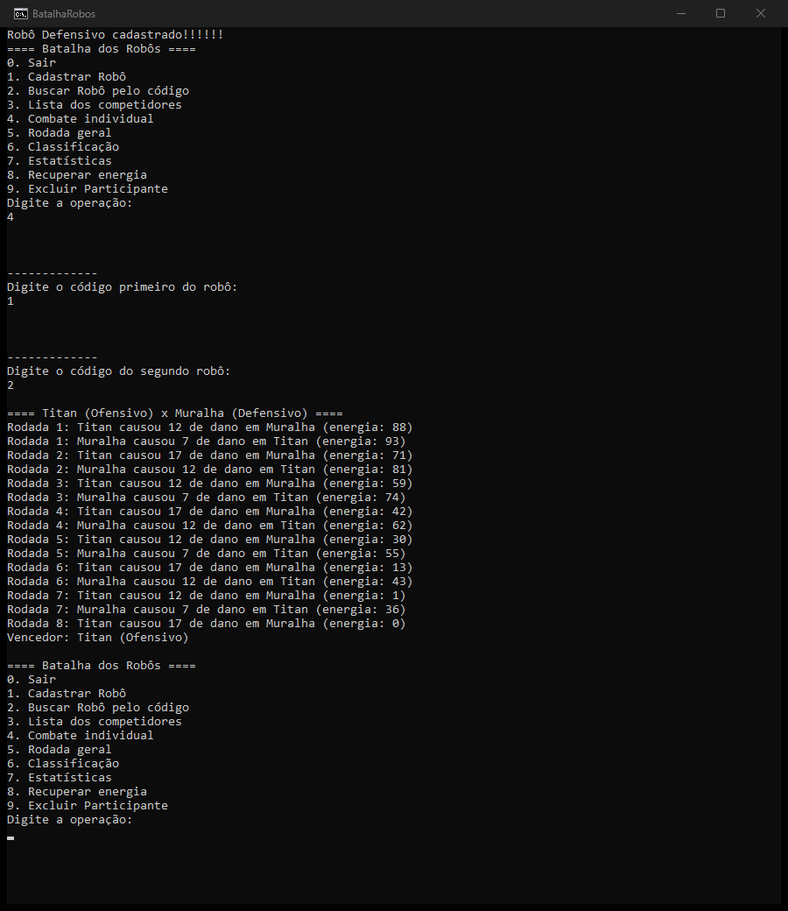
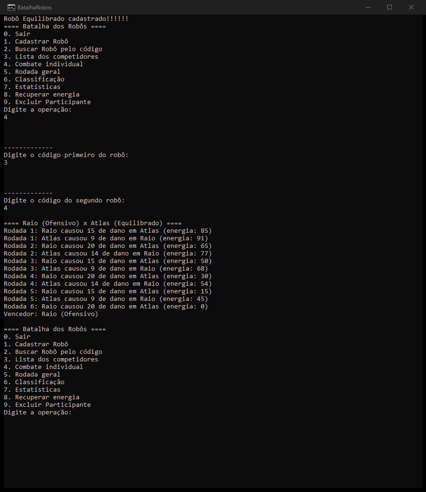
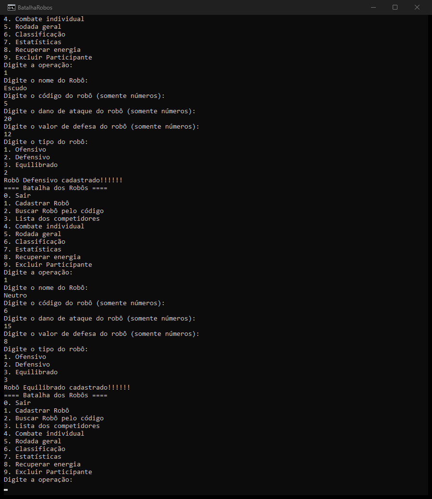
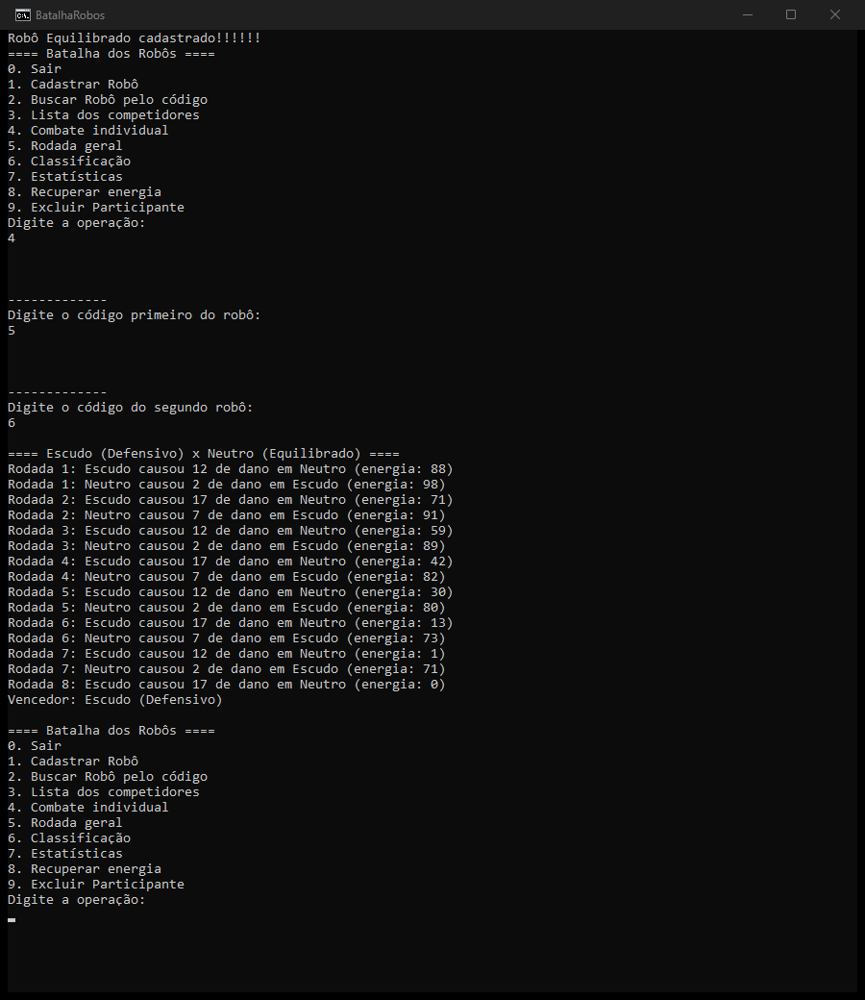

# 🤖 Batalha dos Robôs

Projeto desenvolvido em **Java** para criar uma competição entre robôs através de um sistema executado no terminal.

A aplicação permite **cadastrar, pesquisar, listar, excluir e realizar combates entre robôs**.

---

## 🤖 Cadastro de Robôs

Permite cadastrar um novo robô informando:

* Código
* Nome
* Ataque
* Defesa

Ao ser cadastrado, o robô inicia com:

* ⚡ Energia: `100`
* 🏆 Vitórias: `0`
* ❌ Derrotas: `0`
* ⭐ Pontos: `0`

<div align="center">


</div>

---

## 🔎 Pesquisa de Robô

Permite pesquisar um robô através do seu **código**.

São exibidas informações como:

* Nome
* Código
* Ataque
* Defesa
* Energia
* Vitórias
* Derrotas
* Pontos
* Situação atual

<div align="center">


</div>

---

## 📋 Lista de Competidores

Permite visualizar todos os robôs cadastrados e seus respectivos atributos.

<div align="center">


</div>

---

## 🗑️ Exclusão de Robôs

Permite excluir os robôs que **ainda não batalharam**.

<div align="center">


</div>

---

## ⚔️ Combate entre Robôs

Permite selecionar dois robôs através de seus códigos para realizar um combate.

Durante a batalha, os ataques são realizados e a energia dos robôs é atualizada de acordo com o resultado.

<div align="center">


</div>

---

## 🧪 Testes de Combate por Tipo

Testes executados no terminal para cada combinação de tipos: **Ofensivo x Defensivo**, **Ofensivo x Equilibrado** e **Defensivo x Equilibrado**.
Para cada combate foram cadastrados dois robôs novos (energia `100`), e em seguida foi feito o combate individual (opção `4`).

### 📐 Fórmula do dano (`Robo.atacar`)

```
1. poder  = ataque do agressor            (Ofensivo: ataque + 5)
2. dano   = poder - defesa do alvo
3. se dano < 5           → dano = 5       (dano mínimo)
4. se a rodada for par   → dano + 5       (bônus de rodada par)
5. se o alvo for Defensivo → dano - 3, nunca menor que 2
   (Ofensivo e Equilibrado não alteram o dano recebido)
```

Quem ataca primeiro é o robô com **menos pontos**; em caso de empate, o de **menor código**.

### Robôs utilizados

| Combate | Robô | Código | Tipo | Ataque | Defesa |
|---|---|:---:|---|:---:|:---:|
| 1 | Titan | 1 | Ofensivo | 20 | 5 |
| 1 | Muralha | 2 | Defensivo | 12 | 10 |
| 2 | Raio | 3 | Ofensivo | 18 | 6 |
| 2 | Atlas | 4 | Equilibrado | 15 | 8 |
| 3 | Escudo | 5 | Defensivo | 20 | 12 |
| 3 | Neutro | 6 | Equilibrado | 15 | 8 |

---

### ⚔️ Combate 1 — Ofensivo x Defensivo (Titan x Muralha)

**Cadastro dos robôs**

<div align="center">


</div>

**Combate**

<div align="center">



</div>

**Cálculo do golpe — Rodada 2: Titan causou 17 de dano em Muralha**

| Passo | Cálculo | Resultado |
|---|---|:---:|
| Poder de ataque (Ofensivo +5) | 20 + 5 | 25 |
| Menos a defesa do alvo | 25 − 10 | 15 |
| Dano mínimo (5) | 15 ≥ 5, mantém | 15 |
| Bônus de rodada par | 15 + 5 | 20 |
| Redução do Defensivo (−3, mín. 2) | 20 − 3 | **17** |

Energia de Muralha: 88 − 17 = **71** ✅

**Vencedor:** Titan (Ofensivo), na rodada 8.

---

### ⚔️ Combate 2 — Ofensivo x Equilibrado (Raio x Atlas)

**Cadastro dos robôs**

<div align="center">


</div>

**Combate**

<div align="center">



</div>

**Cálculo do golpe — Rodada 2: Raio causou 20 de dano em Atlas**

| Passo | Cálculo | Resultado |
|---|---|:---:|
| Poder de ataque (Ofensivo +5) | 18 + 5 | 23 |
| Menos a defesa do alvo | 23 − 8 | 15 |
| Dano mínimo (5) | 15 ≥ 5, mantém | 15 |
| Bônus de rodada par | 15 + 5 | 20 |
| Ajuste do Equilibrado | sem alteração | **20** |

Energia de Atlas: 85 − 20 = **65** ✅

**Vencedor:** Raio (Ofensivo), na rodada 6.

---

### ⚔️ Combate 3 — Defensivo x Equilibrado (Escudo x Neutro)

**Cadastro dos robôs**

<div align="center">



</div>

**Combate**

<div align="center">



</div>

**Cálculo do golpe — Rodada 1: Neutro causou 2 de dano em Escudo**

Esse golpe mostra as duas regras de dano mínimo funcionando juntas:

| Passo | Cálculo | Resultado |
|---|---|:---:|
| Poder de ataque (Equilibrado) | 15 | 15 |
| Menos a defesa do alvo | 15 − 12 | 3 |
| Dano mínimo (5) | 3 < 5, sobe para 5 | 5 |
| Bônus de rodada par | rodada 1 é ímpar | 5 |
| Redução do Defensivo (−3, mín. 2) | 5 − 3 = 2 (≥ 2) | **2** |

Energia de Escudo: 100 − 2 = **98** ✅

**Vencedor:** Escudo (Defensivo), na rodada 8.
